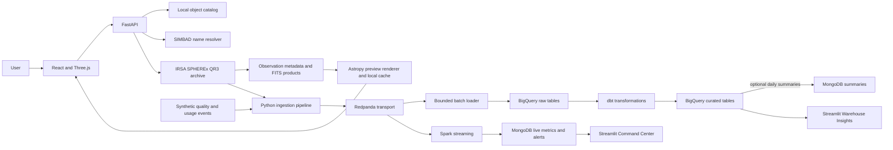

# Cosmic Eye

Cosmic Eye combines a SPHEREx infrared archive explorer with a separate big-data analytics pipeline. The main app lets users search by astronomical object name or sky coordinates, inspect IRSA archive coverage, view infrared previews, and explore catalog objects on an immersive sky map.

> Independent prototype for the 2026 NASA Space Apps Challenge. Cosmic Eye is not an official NASA product and does not claim to detect or confirm new objects.

## Features

| Area | What it does | Data and limits |
| --- | --- | --- |
| Search (`/explore`) | One page for object-name lookup and coordinate search. The old `/ai-search` URL redirects here. | Names use the local catalog first, then SIMBAD for coordinate resolution. “AI Search” is not a generative AI feature. |
| Sky Map (`/skymap`) | Full-window interactive celestial sphere with drag-to-rotate, scroll-to-zoom, coordinate grid, constellation guides, bright-star labels, and a hideable target panel. | Plots 4,992 Hipparcos stars and the curated SPHEREx target catalog at their catalog RA/Dec. Selected targets are checked against SPHEREx QR3 at IRSA. The Milky Way band is illustrative. |
| Archive previews | Opens SPHEREx image products with band, observation, and source metadata. | Previews are false-color renderings of FITS data. First-time previews can take longer while a product downloads and is rendered; generated previews are cached locally. |
| Browse and Popular Regions | Browse a sample of recent archive products or search curated sky regions. | Browse uses a fixed sample field; it is not a mission-wide date feed. |
| Color Lab (`/rgb`) | Explore wavelength bands, palettes, and observations near a sky coordinate. | Display palettes do not represent visible-light colors. Multi-band comparisons are illustrative, not calibrated spectra. |
| Command Center (`http://localhost:8501`) | Shows Redpanda reachability, freshness of Spark output, MongoDB status, live KPIs, and pipeline charts. | Runs separately from the React app. Live demo events and quality values are synthetic. |
| Data Flow (Streamlit page) | Interactive live-stream and batch-warehouse diagrams. Select a pipeline, click stages for inputs/process/output, and browse field catalogs. | Describes the actual retained schemas, including fields deliberately omitted from the live Spark projection. |
| Warehouse Insights (Streamlit page) | Queries curated BigQuery tables and explains archive-backed versus synthetic measurements. | Requires Google Cloud project access, BigQuery Job User, and read access to the curated dataset. |
| Scheduled warehouse ETL (GitHub Actions) | Runs dbt builds and data-quality checks hourly and on relevant pushes to `main`. | Refreshes curated tables from rows already in BigQuery raw; it does not fetch new IRSA records. Requires the `GCP_SERVICE_ACCOUNT_KEY` repository secret and Google Cloud IAM access. |

## Architecture



The Streamlit **Data Flow** page is an interactive guide to the two pipeline paths; it reads no pipeline records itself.

## Data and AI status

- Sky searches use the current IRSA SPHEREx `spherex_qr3` collection. QR2 measurements in older reports are historical and are not the active search source.
- Name resolution is deterministic catalog lookup followed by SIMBAD. There is no active LLM, generative assistant, or trained image-classification model.
- Wavelength labels use fixed ranges. They do not describe detected image contents.
- The Sky Map’s star coordinates come from the bundled Hipparcos catalog. Constellation outlines and the Milky Way guide band are visual aids; the latter is not observed SPHEREx imagery.
- Galaxy markers are symbols at catalog coordinates. They are not measured depictions of galaxy shape or distance.
- Archive tile coordinates identify each product’s field center; a tile can cover a target even when the field center is elsewhere. A preview may show a wide field rather than a close-up.
- The repository still contains an older Solar System visualization and API service, but there is no Solar System tab in the current Sky Map UI.
- Quality values and usage events in the analytics pipeline are synthetic. Do not present them as spacecraft telemetry or user-tracking data.

## Local setup

### Main web app

Requirements: Python 3.11, Node.js/npm, and an internet connection for IRSA and SIMBAD requests.

From the repository root, create the backend environment and install dependencies:

```powershell
py -3.11 -m venv backend\.venv
backend\.venv\Scripts\python.exe -m pip install -r backend\requirements.txt
```

Start the API in one terminal:

```powershell
cd backend
.\.venv\Scripts\python.exe -m uvicorn app.main:app --reload --port 8000
```

Start the frontend in another terminal:

```powershell
cd frontend
npm ci
npm run dev
```

Open `http://localhost:5173`. Vite proxies `/api` requests to the backend at `http://localhost:8000`. The API health endpoint is `http://localhost:8000/api/v1/health`; interactive API docs are at `http://localhost:8000/docs`.

On Bash systems, `./run.sh` starts the backend and frontend. It does not start Streamlit or the analytics pipeline.

### Analytics dashboard and Docker pipeline

The dashboard and pipeline have their own dependencies and configuration. Read the [pipeline setup guide](docs/PIPELINE_README.md) and [Windows setup guide](docs/PHASE1_SETUP.md) before starting them.

For local configuration, copy `.env.example` to `.env` and fill in real values. In particular, replace the suggested `GCP_PROJECT_ID` with the actual project ID that owns the warehouse. Do not commit `.env` or credential files.

From the repository root, Docker Compose reads the root environment file explicitly:

```powershell
docker compose --env-file .env -f infra/compose.yaml up -d
```

The Streamlit app runs on port 8501. With the pipeline virtual environment installed, start it from the repository root:

```powershell
pipeline\.venv\Scripts\python.exe -m streamlit run dashboard\app.py --server.port 8501
```

The main page is the **Cosmic Eye Command Center**. Use Streamlit’s page selector to open **Data Flow** for the interactive architecture and field guide or **Warehouse Insights** for BigQuery charts. The Command Center needs a reachable `MONGODB_URI`; Warehouse Insights needs `GCP_PROJECT_ID`, Google Application Default Credentials or a local service-account credential path, BigQuery Job User access, and read access to the curated dataset. The project ID in `.env.example` is only a suggested ID; use the project you actually own or can access. Never paste or commit service-account keys.

The GitHub Actions workflow at `.github/workflows/warehouse-etl.yml` runs dbt hourly at 17 minutes past the hour in India time and on relevant pushes to `main`. Before it can access Google Cloud, add the service-account JSON document as the repository Actions secret `GCP_SERVICE_ACCOUNT_KEY`. Grant that account BigQuery Job User on the project, read access to the `raw` dataset, and write access to `curated`. It transforms data already loaded to `raw`; batch ingestion from IRSA remains a separate command. Scheduled workflows run from the repository’s default branch, so the workflow must be pushed to `main` and Actions enabled. Never put the key in this repository or paste it into chat.

## Main API

Routes are mounted under `/api/v1`:

| Endpoint | Purpose |
| --- | --- |
| `GET /health` | API liveness and version. |
| `GET /observations?ra=...&dec=...` | Search SPHEREx image products by sky coordinates; QR3 is the default collection. |
| `GET /observations/ai-search?q=...` | Backend name-resolution endpoint used by the unified Search page. The route name is historical. |
| `GET /observations/featured` | Return the built-in target catalog used by the Sky Map. |
| `GET /observations/wavelengths?ra=...&dec=...` | Return available bands and observation groups for Color Lab. |
| `GET /observations/preview?url=...&palette=...` | Return a cached or newly generated single-band JPEG. |
| `GET /observations/preview/rgb?url1=...&url2=...&url3=...` | Return an experimental three-file color composite. |
| `GET /observations/solar-system-model` | Legacy data endpoint; not used by the current Sky Map UI. |

See the live OpenAPI page at `/docs` for parameters, validation, and response models.

## Project documentation

- [Current implementation handoff](handoffs/handoff_updated.md)
- [Big-data pipeline guide](docs/PIPELINE_README.md)
- [Data provenance](docs/data_provenance.md)
- [Science and interpretation limits](docs/science_and_limitations.md)
- [Project reports and measured pipeline results](docs/FINAL_REPORT.md)
- [Requirements evidence checklist](docs/REQUIREMENTS_CHECKLIST.md)

## License and attribution

Project source code is licensed under the MIT License; see [LICENSE](LICENSE). NASA/IPAC IRSA products, SIMBAD data, astronomical catalogs, and third-party images retain their own terms and attribution requirements. Cosmic Eye is independent and is not affiliated with or endorsed by NASA, JPL, Caltech, or the SPHEREx mission team.
