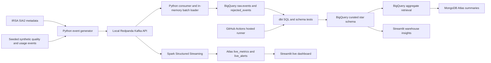

# Final Project Report — Cosmic Eye Telemetry Pipeline

**Course:** Big Data Analytics — 23BSDA5D54, Jain University
**Team:** `[FILL IN MEMBER 1 NAME]`, `[FILL IN MEMBER 2 NAME]`
**GitHub repository:** `https://github.com/chaithanyabs441-ux/cosmic-eye-telemetry-pipeline`
**Report evidence captured:** 2026-11-11
**Project status:** implementation and scale evidence are available; final scheduled-run proof, team names, and final demo screenshots must be filled in before submission.

**Final audit:** Phase 10 setup dry-run and teardown-script dry-runs passed. The frontend typecheck passed. The backend Ruff check found 87 lint findings, and pytest discovered no tests; see `docs/REQUIREMENTS_CHECKLIST.md`. Teardown has not been run. Follow `docs/TEARDOWN_CHECKLIST.md` only after the final demo/viva.

## 1. Problem statement

Cosmic Eye is an astronomy application that presents public SPHEREx archive
observations. The course project extends it with a big-data pipeline that
demonstrates how observation metadata and anonymous synthetic app events can be
ingested, validated, cleaned, stored in a cloud warehouse, queried, summarized
in a NoSQL database, and processed as a live stream.

The project asks two practical questions: how do synthetic quality indicators
vary across observation bands and sky regions, and how do synthetic application
requests vary by action, latency, and HTTP error rate? It is a course-scale
analytics demonstration. Synthetic quality indicators are not NASA instrument
measurements, and this work does not claim that they are.

## 2. Dataset and provenance

There are three raw record shapes: exposure events, synthetic app-usage events,
and rejected/dirty events with a validation reason. Exposure events can include
real public IRSA metadata fields, while the quality metrics, event envelope, and
many generated exposure rows are synthetic. Every event carries a synthetic
marker and provenance in its raw JSON payload. App usage records use generated
anonymous session IDs and contain no real user or personal data.

### Captured scale run

The completed synthetic continuation used seed 43 and generated 860,000 events.
The previous seed-42 IRSA-sourced attempt was interrupted after 160,000 rows
had landed. The final BigQuery counts include both runs; the partial run is
reported as partial, not as a completed IRSA harvest.

| Raw record category | Rows | Provenance interpretation |
|---|---:|---|
| Accepted exposure events | 528,621 | 84,120 use metadata returned by IRSA SIA2; 444,501 use seeded synthetic metadata. Quality metrics and event envelopes are synthetic in both groups. |
| Accepted synthetic app-usage events | 477,461 | Seeded generator; anonymous session IDs. |
| **Accepted raw events total** | **1,006,082** | The million-row raw volume target is met. |
| Ingestion rejects | 14,338 | Dirty records rejected because `event_type` was not `exposure` or `usage`. |

The 84,120 count is a count of event rows carrying IRSA-sourced observation
metadata, not a count of unique SPHEREx observations. Metadata can be replayed
in multiple generated event envelopes. `source` is kept with provenance, and
`is_synthetic=true` reflects that quality values/event generation are
synthetic—even when an event references public IRSA metadata.

### Volume, velocity, and variety

- **Volume:** 1,006,082 accepted raw events plus 14,338 ingestion rejects in
  BigQuery. Curated facts contain 511,456 exposures and 460,310 app events after
  deduplication and schema cleaning.
- **Velocity:** the completed batch measured 959.49 events/second published
  through the broker and 946.84 events/second end-to-end to BigQuery. An earlier
  finite live pilot measured 200 events/second producer rate and 25.30
  events/second end-to-end. The batch figure is not live dashboard latency.
- **Variety:** exposure metadata, synthetic usage events, and rejected/dirty
  rows. The event envelopes are JSON; curated data is typed BigQuery tables;
  MongoDB stores compact aggregate documents.

The 860,000-event continuation took 908.282 seconds end-to-end and used 87
BigQuery batch load jobs of at most 10,000 input rows each. Producer, consumer,
landed, and rejected counts reconciled exactly.

## 3. Architecture and design

The local broker is temporary transport, not the primary dataset store. Event
payloads are buffered in memory for BigQuery load jobs. Raw and curated primary
data remain in BigQuery; MongoDB contains derived daily summaries and live
metrics/alerts. The project does not save the generated history to local CSV,
JSONL, Parquet, or SQLite files.

The star schema consists of `fact_exposures`, `fact_usage_events`, and
`dim_band`, `dim_region`, and `dim_date`. Both facts share band, region, and date
keys so warehouse SQL can compare exposure and synthetic app activity.

## 4. Tools and trade-offs

| Layer | Choice | Reason and limitation |
|---|---|---|
| Generation / ingestion | Python 3.11, Redpanda, BigQuery batch-load client | Reproducible seeded events and temporary Kafka-compatible transport. Batch load jobs fit Sandbox restrictions; they do not provide warehouse-side streaming inserts. |
| Cloud warehouse | BigQuery Sandbox, `raw` and `curated` datasets | Raw and curated primary tables stay in the cloud. Sandbox storage and expiration limits mean the warehouse is not a permanent archive. |
| ETL | dbt-bigquery on GitHub Actions | SQL transformation and data tests run on a hosted scheduler. Runs can be delayed, and scheduled-run history must be captured from GitHub Actions. |
| NoSQL | MongoDB Atlas M0 | Document model fits region/band summaries and alert records. Only derived summaries and live output are stored there. |
| Streaming | Spark Structured Streaming | Three continuous queries: one-minute counts, five-minute sliding latency/errors, and event-triggered alerts. Runs in a Linux container with Redpanda. |
| Dashboards | Streamlit | Local dashboard reads live Atlas data and curated BigQuery aggregates. The PC and Docker must be running for the live local stream demo. |

The Spark job uses a two-minute event-time watermark and a five-second trigger.
Local logs observed some batches taking 5.105 and 6.233 seconds, longer than the
trigger interval. These are actual local observations, not a latency guarantee.

The live demo has `normal` and `incident` synthetic scenarios. In a measured
five-minute run, the normal baseline minute alerted on 1.17% of events. During
the incident, `sky_23_00` reached 2.91 times its baseline event count and the
overall alert rate reached 15.96%. This is generated test telemetry, not a
report of real SPHEREx conditions.

GitHub-hosted Actions uses changing IPs. To avoid opening Atlas to the whole
internet for the scheduled job, the workflow runs BigQuery dbt only. The local
`pipeline/sync_mongodb.py` performs the BigQuery-to-Atlas transfer when the
project PC's IP is allowed by Atlas. The GitHub Actions runner does not require
the student's PC to remain on.

## 5. Processing and data quality

The ETL parses JSON payloads into typed fields, rejects invalid schema rows,
deduplicates event IDs, normalizes wavelength values to micrometres, derives
calendar and sky-cell dimensions, and converts selected noisy/out-of-range
values to `NULL`. Required dimensions/facts are checked with dbt unique and
not-null tests.

At the 1M scale, dbt completed 22/22 nodes successfully in 54.85 seconds: six
table models, one view, and fifteen tests. The verification query reported
17,165 excess duplicate exposure rows and 103 excess duplicate usage rows.
There were 17,052 curated preprocessing rejects, mainly wrong-type latency
values. Counts are from actual BigQuery queries, not generated example output.

## 6. Querying and optimization

Eight analytical BigQuery queries cover joins, aggregation, `GROUP BY` with
`HAVING`, scalar subqueries, common table expressions, ranking, running totals,
and moving averages. Six MongoDB query examples cover filters/projections,
aggregation pipelines, stable-ID lookup, recent alerts, and a compound-index
lookup. Three continuous Spark queries cover tumbling counts, sliding app
metrics, and alert filters. The query appendix contains the query text, business
question, actual captured result samples, and measured timings.

Optimization used the same MongoDB region/band query in 15 runs per plan. A
forced collection scan had median client elapsed time 20.94 ms and examined 161
documents. The compound `region_band_day_lookup` index had median 20.68 ms and
examined one document and one key. Both returned the same result. The apparent
0.26 ms wall-time difference is smaller than likely network variation; the
measured reduction in documents examined is the more useful evidence at this
pilot size.

## 7. Scale and free-tier usage

Read-only BigQuery table metadata after the scale run showed:

- Raw logical storage: 935,214,301 bytes (about 0.871 GiB).
- Curated logical storage: 264,115,523 bytes (about 0.246 GiB).
- Combined raw and curated logical storage: 1,199,329,824 bytes (about 1.12 GiB).
- Largest observed dbt model scan: approximately 861.9 MiB.

These values are below the currently documented BigQuery Sandbox allowance of
10 GiB lifetime storage and 1 TiB of query processing each month. Sandbox table
and partition expiration defaults to 60 days, so this project does not claim
permanent storage. Batch load jobs were used; Sandbox does not support the
streaming insert path in this design.

Atlas `dbStats` measured 210,248 bytes of document data, 229,376 bytes of
collection storage, and 303,104 bytes of indexes across five collections and
nine indexes. The current data footprint is about 0.51 MiB including indexes,
well below the M0 0.5 GB cap. These numbers can change as live demo data is
written.

The selected BigQuery Sandbox project has no linked billing account. A
Cloud Billing budget alert therefore is not available in this configuration;
usage is monitored by warehouse metadata and Actions usage. GitHub-hosted
Actions may be delayed, and their schedule is not a precise real-time scheduler.

## 8. Results and limitations

The project demonstrated batch ingestion, dirty-data handling, warehouse ETL,
NoSQL retrieval, analytical SQL, continuous windows/alerts, and a dashboard.
The data volume exceeds one million accepted raw event rows, and the live query
outputs are reproducible from the documented commands.

Limitations:

- Most rows are synthetic. Public archive metadata does not make the synthetic
  quality metrics real science measurements.
- The interrupted first scale attempt left a partial 160,000-row run in the
  warehouse; its rows are included in final counts and provenance.
- The live Spark throughput is not the same as the measured batch-ingestion
  throughput. The local stream occasionally misses the five-second trigger.
- Atlas warehouse sync runs locally rather than on the GitHub hosted runner.
- Two successful scheduled GitHub Actions runs have not yet been independently
  recorded in the repo's Phase 4 evidence. Confirm this from Actions before
  claiming the scheduler demonstration fully satisfies R4.4-b.
- No final oral demo screenshot or two-member presentation rehearsal is
  checked into this repo yet.

## 9. What we learned

1. BigQuery Sandbox constraints influenced the ingestion method: bounded batch
   load jobs were needed, and DML/streaming inserts were not used.
2. Partitioning by ingestion time preserved old backfilled event times within
   the Sandbox retention period.
3. Deduplication and typed schema validation are essential because a generator
   can deliberately produce duplicates and invalid values.
4. MongoDB's compound index reduced documents examined from 161 to 1, even
   though the small pilot and network delay hid a wall-time gain.
5. The live dashboard is useful only when Redpanda, Spark, Atlas connectivity,
   and the local Streamlit app are all reachable.

## 10. Required student additions before submission

- Replace both member-name placeholders with the actual team names.
- Add final screenshots: successful scheduled GitHub Actions runs, BigQuery
  row-count/usage evidence, dashboard live metrics/alerts, and the warehouse
  insights page. Do not show credentials, IP addresses, or database URIs.
- If claiming R4.4-b fully passed, capture two successful runs whose GitHub
  event type is **Scheduled**. Manual runs are not a substitute.
- Rehearse the demo with both team members and ensure both can explain all
  pipeline stages.

## References

See [`REFERENCES.md`](REFERENCES.md) for dataset, service, library, and official
documentation citations. Query-specific results and SQL are in
[`QUERY_APPENDIX.md`](QUERY_APPENDIX.md).
