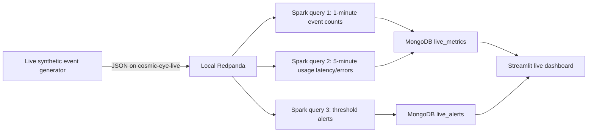

# Phase 6: Live streaming metrics and dashboard

## Data flow



The producer creates synthetic events and synthetic quality metrics. Its
`normal` scenario is the default. The `incident` scenario boosts one region
between run minutes 2 and 4, while keeping the base event cadence steady. The
producer publishes only to a bounded Redpanda topic;
Spark checkpoint files contain processing offsets/state metadata, not event
history. The curated/raw BigQuery tables remain the primary data store.

Spark runs three concurrent Structured Streaming queries:

1. One-minute tumbling event counts by region and band.
2. Five-minute sliding usage latency, p95 latency, and HTTP error counts by
   region. Both aggregation queries use a two-minute event-time watermark to
   accept events that arrive late and discard events later than the watermark.
3. Event-triggered alerts for configurable exposure noise/saturation
   thresholds, usage latency, and HTTP errors. Reasons are
   `exposure_quality_threshold`, `high_latency`, or `http_error`. Alert
   documents use `event_id` as their stable key.

Thresholds are read from `ALERT_LATENCY_MS` (default 5000 ms),
`ALERT_NOISE_SIGMA` (default 1.1), and `ALERT_SATURATED_FRACTION` (default
0.6). These defaults keep normal traffic alerts uncommon while the incident
region produces an obvious latency/error spike. Docker Compose passes these
settings into Spark; set them in the private `.env` if you want to tune the
demo. The example values are in `.env.example`.

Window summaries are upserted to `cosmic_eye.live_metrics`; alerts are upserted
to `cosmic_eye.live_alerts`. The dashboard refreshes every five seconds and
shows KPI cards and charts for events by band, request latency, HTTP error rate,
alert reasons, alert volume by minute, and busiest regions. Sidebar controls
select a 5, 15, 30, or 60-minute range (or all available records) and pause or
resume auto-refresh. Mongo timestamps are displayed in Asia/Kolkata. The
Spark Kafka connector version is
matched to PySpark 4.3.0 and Scala 2.13 as specified by Apache Spark's 4.3.0
Kafka guide. Spark runs inside a Linux Docker container; this avoids the
Windows Hadoop `winutils.exe` requirement encountered when launching the
Spark Kafka package resolver directly on Windows.

## Start on Windows

Start Docker Desktop from the Windows Start menu and wait for the engine to
say it is running. Confirm the Atlas IP list includes your PC's current public
IP. Do not leave the temporary `0.0.0.0/0` access entry enabled.

For the one-command demo, open PowerShell at the repository root and run:

```powershell
powershell -ExecutionPolicy Bypass -File scripts\demo_streaming.ps1
```

The script checks Redpanda health, creates the live topic, starts the three
Spark queries, starts the Streamlit dashboard, and launches this producer
command in the background:

```powershell
pipeline\.venv\Scripts\python.exe pipeline\live_producer.py --rate 50 --duration 300 --regions 12 --scenario incident --incident-region sky_23_00 --seed 42
```

The first two minutes establish baseline; `sky_23_00` has 3× event volume,
3–4× usage latency, and about 25% HTTP errors during minutes 2–4; minute 4–5
shows recovery. The producer uses uneven band/region weights, unique event IDs,
and small timing jitter. The dashboard opens while the synthetic feed runs. The
first Spark run may take longer while it downloads the official Kafka
connector. To stop all demo processes and Redpanda:

```powershell
powershell -ExecutionPolicy Bypass -File scripts\stop_streaming_demo.ps1
```

For troubleshooting, the equivalent manual steps are:

1. In one PowerShell window, start Redpanda:

   ```powershell
   docker compose --env-file .env -f infra/compose.yaml up -d
   docker compose --env-file .env -f infra/compose.yaml ps
   ```

   Expected: `redpanda` is `Up`/`healthy` and host port `9092` is published.

2. In a second window, create the topic and start the Spark container. The
   first image build and connector download may take several minutes:

   ```powershell
   pipeline\.venv\Scripts\python.exe pipeline\live_producer.py --create-topic-only
   docker compose --env-file .env -f infra/compose.yaml --profile streaming up -d --build spark-streaming
   ```

   Follow the log until it prints `Spark Structured Streaming started: topic=cosmic-eye-live; three queries active; watermarks=2 minutes`:

   ```powershell
   docker compose --env-file .env -f infra/compose.yaml --profile streaming logs -f spark-streaming
   ```

3. In a third window, send the five-minute incident scenario:

   ```powershell
   pipeline\.venv\Scripts\python.exe pipeline\live_producer.py --rate 50 --duration 300 --regions 12 --scenario incident --incident-region sky_23_00 --seed 42
   ```

   Expected: about 18,000 events after five minutes. The first two minutes are
   baseline, minutes 2–4 are the incident, and minute 4–5 is recovery. Press
   Ctrl+C to stop early. Seed 42 repeats event values/distribution, while event
   timestamps and unique IDs identify this run.

4. In another window, launch the dashboard:

   ```powershell
   pipeline\.venv\Scripts\python.exe -m streamlit run dashboard\app.py
   ```

   Open `http://localhost:8501`. Expected: live metric rows and exposure alerts
   appear and refresh without clicking. The terminal running Spark should log
   micro-batches and alert upserts.

5. Stop Spark and Redpanda when the demo is finished:

   ```powershell
   docker compose --env-file .env -f infra/compose.yaml --profile streaming down
   ```

The Docker commands require Docker Desktop's Linux engine to be running. The
Spark worker mounts the PySpark package already installed in the Windows venv
read-only, avoiding a second download of its 422 MB jar set into the image.

## Live verification record

- Java: local `java -version` reported Temurin OpenJDK `17.0.21`; Spark 4.3.0
  supports Java 17.
- PySpark: local environment reports version `4.3.0`.
- Local Spark startup: Java 17 created a `local[2]` session and `spark.range(5).count()` returned `Spark local range count: 5` (exit code 0). Windows emitted optional `winutils.exe`/native-Hadoop warnings and an access-denied cleanup message after completion; the Spark computation itself passed.
- Static checks: Python compilation passed for the producer, Spark job, and Streamlit page; both PowerShell demo scripts parsed without syntax errors.
- Docker: `docker compose --env-file .env -f infra/compose.yaml ps` reported Redpanda `Up ...
  (healthy)` on host port `9092` after the user started Docker Desktop.
- Direct Spark-on-Windows attempt: connector artifacts downloaded, then Spark
  failed because Hadoop requires `winutils.exe` for this package-download path.
  The demo now runs Spark in a Linux container to avoid that Windows-only local
  runtime issue.
- Linux-container Spark startup: logs reported `Spark Structured Streaming
  started: topic=cosmic-eye-live; three queries active; watermarks=2 minutes`.
- Live producer: a 40-event burst reported `published=40` and `injected
  anomalies=6`; the one-command demo sent a second 40-event burst with 6 more
  injected anomalies.
- Spark-to-Mongo logs showed `live_alerts` upserts and `live_metrics` upserts
  for the 1-minute and 5-minute window queries.
- Dashboard: `Invoke-WebRequest http://localhost:8501/_stcore/health` returned
  HTTP 200.
- Atlas read-only verification: `pipeline\.venv\Scripts\python.exe
  pipeline\verify_streaming.py` reported 222 live metric documents and 22 live
  alert documents: 42 event-count summaries, 180 usage-window summaries, 12
  exposure-quality alerts, and 10 usage-latency/error alerts.
- The restricted Atlas IP list worked after removal of the temporary wildcard.
  Do not restore `0.0.0.0/0`.

## Earlier varied-stream verification (before scenario controls)

- `python -m py_compile dashboard/app.py pipeline/live_producer.py
  pipeline/streaming.py` completed with exit code 0.
- Streamlit AppTest against the Atlas data returned 0 exceptions, 5 KPI cards,
  6 chart specs, and 3 detail tables. The detail tables had no all-null columns.
- The producer ran with `--rate 50 --duration 120 --regions 12 --seed 42` and
  reported 6,000 published synthetic events, 264 varied exposure anomalies,
  and 582 high-latency burst events.
- Read-only Atlas check for recent results found 192 event-window documents
  across 12 regions and all four bands (`SPHEREx-D1` through `SPHEREx-D4`);
  the largest region/band one-minute count was 82, and every observed window
  row had a count greater than one.
- The same check found 1,846 recent alerts across 12 regions with all three
  reasons: `exposure_quality_threshold`, `high_latency`, and `http_error`.
- Atlas reported 913,408 bytes for the live database's collection storage plus
  indexes after these demo runs (under 1 MiB combined).

## Incident scenario verification

- Seeded sampler check (100,000 normal events): 1,619 crossed the configured
  alert thresholds (1.62%). In 20,000 incident usage samples, 24.51% returned
  HTTP errors and 43.19% exceeded the 5,000 ms latency alert threshold. Event
  object keys remained unchanged.
- Updated Spark container log: three queries active with thresholds
  `latency_ms>=5000`, `noise_sigma>=1.1`, and `saturation>=0.6`.
- End-to-end command `pipeline\.venv\Scripts\python.exe
  pipeline\live_producer.py --rate 50 --duration 300 --regions 12 --scenario
  incident --incident-region sky_23_00 --seed 42` published 18,335 events over
  five minutes. Of these, 5,037 events were sent to the incident region during
  the two-minute incident interval (three times the sampled base events there).
- Atlas event-window summaries for the run were 39.6% D1, 30.7% D2, 20.1% D3,
  and 9.6% D4. At the complete incident minute 15:56 UTC, `sky_23_00` had 2,487
  events versus 855 in the complete baseline minute 15:54 UTC (2.91×); total
  events in those minutes were 4,655 and 2,995 respectively.
- Alerts in the run-time query range: 784 `http_error`, 807 `high_latency`,
  and 43 `exposure_quality_threshold`. All three reasons appeared in the
  incident region, where the two-minute rate increase was visible.
- In the full baseline minute at 15:54 UTC, 35/2,995 events alerted (1.17%).
  In the full incident minute at 15:56 UTC, 743/4,655 events alerted (15.96%).
  Atlas collection storage was 643,072 bytes and index storage was 667,648
  bytes at the end of this test.
