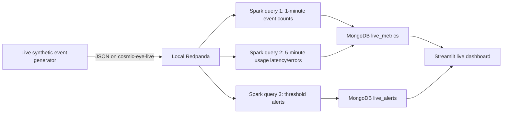

# Phase 6: Live streaming metrics and dashboard

## Data flow



The producer creates synthetic events and synthetic quality metrics. It can
inject a high-noise/high-saturation exposure so the alert query can be shown
working on demand. The producer publishes only to a bounded Redpanda topic;
Spark checkpoint files contain processing offsets/state metadata, not event
history. The curated/raw BigQuery tables remain the primary data store.

Spark runs three concurrent Structured Streaming queries:

1. One-minute tumbling event counts by region and band.
2. Five-minute sliding usage latency, p95 latency, and HTTP error counts by
   region. Both aggregation queries use a two-minute event-time watermark to
   accept events that arrive late and discard events later than the watermark.
3. Event-triggered alerts for exposure noise/saturation thresholds and usage
   latency/HTTP errors. Alert documents use `event_id` as their stable key.

Window summaries are upserted to `cosmic_eye.live_metrics`; alerts are upserted
to `cosmic_eye.live_alerts`. The dashboard refreshes every five seconds and
shows the latest windows and alerts. The Spark Kafka connector version is
matched to PySpark 4.3.0 and Scala 2.13 as specified by Apache Spark's 4.3.0
Kafka guide. Spark runs inside a Linux Docker container; this avoids the
Windows Hadoop `winutils.exe` requirement encountered when launching the
Spark Kafka package resolver directly on Windows.

## Start on Windows

Start Docker Desktop from the Windows Start menu and wait for the engine to
say it is running. Confirm the Atlas IP list includes your PC's current public
IP. Do not leave the temporary `0.0.0.0/0` access entry enabled.

For the one-command demo, open PowerShell at the repository root and run:

```powershell
powershell -ExecutionPolicy Bypass -File scripts\demo_streaming.ps1
```

The script checks Redpanda health, creates the live topic, starts the
three Spark queries, starts the
Streamlit dashboard, publishes 40 synthetic events with injected anomalies,
and opens `http://localhost:8501`. The first Spark run may take longer while it
downloads the official Kafka connector. To stop all demo processes and
Redpanda:

```powershell
powershell -ExecutionPolicy Bypass -File scripts\stop_streaming_demo.ps1
```

For troubleshooting, the equivalent manual steps are:

1. In one PowerShell window, start Redpanda:

   ```powershell
   docker compose --env-file .env -f infra/compose.yaml up -d
   docker compose --env-file .env -f infra/compose.yaml ps
   ```

   Expected: `redpanda` is `Up`/`healthy` and host port `9092` is published.

2. In a second window, create the topic and start the Spark container. The
   first image build and connector download may take several minutes:

   ```powershell
   pipeline\.venv\Scripts\python.exe pipeline\live_producer.py --create-topic-only
   docker compose --env-file .env -f infra/compose.yaml --profile streaming up -d --build spark-streaming
   ```

   Follow the log until it prints `Spark Structured Streaming started: topic=cosmic-eye-live; three queries active; watermarks=2 minutes`:

   ```powershell
   docker compose --env-file .env -f infra/compose.yaml --profile streaming logs -f spark-streaming
   ```

3. In a third window, send a finite, reproducible demo burst with injected
   exposure anomalies:

   ```powershell
   pipeline\.venv\Scripts\python.exe pipeline\live_producer.py --count 40 --rate 2 --inject-anomaly-every 3
   ```

   Expected: `Live generator stopped: published=40; injected anomalies=...`.

4. In another window, launch the dashboard:

   ```powershell
   pipeline\.venv\Scripts\python.exe -m streamlit run dashboard\app.py
   ```

   Open `http://localhost:8501`. Expected: live metric rows and exposure alerts
   appear and refresh without clicking. The terminal running Spark should log
   micro-batches and alert upserts.

5. Stop Spark and Redpanda when the demo is finished:

   ```powershell
   docker compose --env-file .env -f infra/compose.yaml --profile streaming down
   ```

The Docker commands require Docker Desktop's Linux engine to be running. The
Spark worker mounts the PySpark package already installed in the Windows venv
read-only, avoiding a second download of its 422 MB jar set into the image.

## Live verification record

- Java: local `java -version` reported Temurin OpenJDK `17.0.21`; Spark 4.3.0
  supports Java 17.
- PySpark: local environment reports version `4.3.0`.
- Local Spark startup: Java 17 created a `local[2]` session and `spark.range(5).count()` returned `Spark local range count: 5` (exit code 0). Windows emitted optional `winutils.exe`/native-Hadoop warnings and an access-denied cleanup message after completion; the Spark computation itself passed.
- Static checks: Python compilation passed for the producer, Spark job, and Streamlit page; both PowerShell demo scripts parsed without syntax errors.
- Docker: `docker compose --env-file .env -f infra/compose.yaml ps` reported Redpanda `Up ...
  (healthy)` on host port `9092` after the user started Docker Desktop.
- Direct Spark-on-Windows attempt: connector artifacts downloaded, then Spark
  failed because Hadoop requires `winutils.exe` for this package-download path.
  The demo now runs Spark in a Linux container to avoid that Windows-only local
  runtime issue.
- Linux-container Spark startup: logs reported `Spark Structured Streaming
  started: topic=cosmic-eye-live; three queries active; watermarks=2 minutes`.
- Live producer: a 40-event burst reported `published=40` and `injected
  anomalies=6`; the one-command demo sent a second 40-event burst with 6 more
  injected anomalies.
- Spark-to-Mongo logs showed `live_alerts` upserts and `live_metrics` upserts
  for the 1-minute and 5-minute window queries.
- Dashboard: `Invoke-WebRequest http://localhost:8501/_stcore/health` returned
  HTTP 200.
- Atlas read-only verification: `pipeline\.venv\Scripts\python.exe
  pipeline\verify_streaming.py` reported 222 live metric documents and 22 live
  alert documents: 42 event-count summaries, 180 usage-window summaries, 12
  exposure-quality alerts, and 10 usage-latency/error alerts.
- The restricted Atlas IP list worked after removal of the temporary wildcard.
  Do not restore `0.0.0.0/0`.
