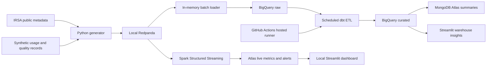

# Cosmic Eye Telemetry Pipeline

This course pipeline extends the existing Cosmic Eye application with batch
ingestion, a cloud warehouse, scheduled ETL, NoSQL summaries, live stream
analytics, and query examples. The original astronomy web app remains separate.

## Current project status

- The 2026-11-11 scale run has 1,006,082 accepted event rows in BigQuery
  `raw.events`, plus 14,338 ingestion-rejected rows.
- The latest local dbt build passed all 22 build/test nodes.
- The repo includes a GitHub Actions hourly BigQuery ETL. GitHub may delay
  scheduled runs. Two successful **scheduled** runs have not been independently
  evidenced in the project notes yet; check **Actions** before presenting R4.4-b
  as fully proven. A manual `workflow_dispatch` run does not count as scheduled
  evidence.
- Atlas summary sync is intentionally local because a GitHub-hosted runner's
  changing public IP cannot be safely allow-listed in the Atlas free project.
- The live dashboard reads Atlas stream metrics. A second page queries BigQuery
  and charts five measured insights.

## Start from Windows PowerShell

Use Windows 10, Python 3.11, Java 17, and Docker Desktop with its Linux/WSL 2
engine. The pipeline uses the local `.env`; keep it private.

1. Install the Python environment if needed:

   ```powershell
   py -3.11 -m venv pipeline\.venv
   pipeline\.venv\Scripts\python.exe -m pip install -r pipeline\requirements.txt
   ```

2. Start the local Redpanda broker:

   ```powershell
   powershell -ExecutionPolicy Bypass -File scripts\start-pipeline.ps1
   ```

3. For a local batch ingestion run (100 rows):

   ```powershell
   pipeline\.venv\Scripts\python.exe pipeline\ingest.py --mode batch --count 100 --seed 42 --source irsa
   ```

   The generator publishes to a temporary Redpanda topic and uses bounded
   in-memory batches to load BigQuery. It deletes its per-run topic afterward.

4. Run ETL and verify counts:

   ```powershell
   pipeline\.venv\Scripts\python.exe pipeline\run_etl.py
   pipeline\.venv\Scripts\python.exe pipeline\verify_etl.py
   ```

5. For the end-to-end live stream demo:

   ```powershell
   powershell -ExecutionPolicy Bypass -File scripts\demo_streaming.ps1
   ```

   It publishes only synthetic demo traffic, including injected anomalies. Open
   `http://localhost:8501`; use Streamlit's page selector to open **1_Warehouse
   Insights** for BigQuery charts. Stop the live workers with
   `scripts\stop_streaming_demo.ps1`; stop/remove the broker with
   `scripts\stop-pipeline.ps1`.

## Query demo

```powershell
pipeline\.venv\Scripts\python.exe queries\run_query.py q01
pipeline\.venv\Scripts\python.exe queries\run_query.py all
pipeline\.venv\Scripts\python.exe queries\nosql\run_queries.py
pipeline\.venv\Scripts\python.exe queries\nosql\run_optimization.py
```

The runner prints the results from the configured warehouse/database. The
captured sample results and query-specific timings are in
[`QUERY_APPENDIX.md`](QUERY_APPENDIX.md). Query definitions and access patterns
are mapped in [`../queries/README.md`](../queries/README.md).

## Architecture



## Project materials

- [Phase reports and the final report](FINAL_REPORT.md)
- [Requirement evidence checklist](REQUIREMENTS_CHECKLIST.md)
- [Proposal and architecture details](PROPOSAL.md)
- [Setup guide](PHASE1_SETUP.md)
- [Demo script](DEMO_SCRIPT.md)
- [Presentation outline](PRESENTATION_OUTLINE.md)
- [References and data credits](REFERENCES.md)
- [Measured query appendix](QUERY_APPENDIX.md)
- [Phase 8 scale and insight measurements](PHASE8_SCALE_INSIGHTS.md)

## Current free-tier notes

The selected warehouse is BigQuery Sandbox. Current usage recorded in Phase 8
is about 1.12 GiB raw plus curated logical storage against its 10 GiB lifetime
allowance. It automatically expires tables/partitions after 60 days. BigQuery
Sandbox requires batch load jobs for this workflow; the project does not use
streaming inserts or DML. Atlas stores derived summaries only, not the primary
event history. See [References](REFERENCES.md) for official service-limit
sources and the measured report for actual usage.
