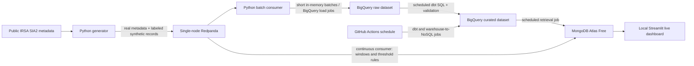

# Cosmic Eye Telemetry Pipeline — Proposal (Phase 0)

**Status:** Draft for approval. No cloud resources have been created.

**Course:** Big Data Analytics, 23BSDA5D54, Jain University  
**Team:** Member 1 — TBD; Member 2 — TBD  
**Google Cloud project ID:** `cosmic-eye-telemetry-demo` (suggested; availability not checked)  
**GitHub repository:** TBD; this workspace currently has no `.git` directory or remote URL.

## Problem statement

Cosmic Eye already searches NASA/IPAC IRSA for public SPHEREx observation metadata, but it does not capture app usage as a data stream or provide a pipeline that measures archive and app behavior. This project will replay public observation metadata alongside clearly labeled synthetic quality values and synthetic app-usage events. A cloud warehouse will retain the raw and cleaned history, while a streaming processor will calculate live summaries and simple threshold alerts for a dashboard.

The result is a course-scale demonstration of ingestion, cloud storage, ETL, preprocessing, NoSQL retrieval, streaming analytics, querying, and reporting. It is not a production observatory, a user-tracking system, or a machine-learning project. Any fabricated measurements are marked synthetic and are never described as NASA measurements.

## Proposed architecture



The local broker is only a short-lived transport buffer. Topics will have bounded retention; generated primary data will not be written to local CSV, JSONL, Parquet, SQLite, or other files. A stop/cleanup command will remove the broker container and its temporary storage. The authoritative raw and curated tables will exist only in BigQuery. MongoDB will hold derived query results and live summaries required by the NoSQL and dashboard stages.

The source adapter will make bounded, documented IRSA SIA2 metadata queries. No FITS image products are needed for this analytics pipeline. Real metadata fields (such as observation ID, wavelength bounds, sky position, observation time, calibration level, and access URL) retain a source and retrieval timestamp. Synthetic quality metrics and synthetic usage records receive `is_synthetic=true` and generator provenance. Real archive records receive `is_synthetic=false` and IRSA provenance. Synthetic sessions use random anonymous IDs and contain no personal data.

## Proposed tools and trade-offs

| Pipeline layer | Proposed tool | Reason and constraint |
|---|---|---|
| Event generator and schema checks | Python 3.11, Pydantic | Reuses the repository's Python version and keeps generation/validation small. Synthetic quality fields use deterministic thresholds and are not ML. |
| Message bus | One local Redpanda Community broker in Docker, development mode | Kafka-compatible, no cloud charge, and lighter to operate than a multi-service Kafka setup. Use only the free Community features, not the time-limited Enterprise trial. Redpanda's Docker quickstart asks for at least 4 GiB free before starting containers, so the broker must be resource-checked and run without optional Console/Connect services. |
| Raw and curated warehouse | Google BigQuery Sandbox | Matches the course's recommended free option. Current documented limits require batch load jobs, not streaming inserts or DML. Raw batches will be loaded directly from memory; dbt will rebuild curated tables rather than use incremental `MERGE`. |
| ETL and scheduler | dbt-bigquery SQL, hourly GitHub Actions workflow | Warehouse-side SQL avoids running Spark locally. Phase 4 measured a full build at about 50 seconds for 22 model/test nodes; hourly scheduling reduces monthly runner-minutes and BigQuery scans while meeting the course's automated-schedule requirement. GitHub Free includes a limited monthly runner allowance for private repositories; public standard-runner usage is free. Schedules can be delayed, so the project records actual run times. |
| Live stream processing | PySpark Structured Streaming reading Redpanda's Kafka API | Matches the course's named streaming tools and supports event-time windows/watermarks. Use one local Spark process and three queries: 1-minute event counts by region/band; 5-minute rolling latency/error rate with an alert threshold; and per-exposure synthetic quality threshold alerts. |
| NoSQL | MongoDB Atlas Free cluster (M0) with PyMongo | Document storage fits region summaries, observation summaries, and alert documents; the course requires retrieval from the warehouse. The free cluster has a 0.5 GB storage cap and 100 operations/second, so only compact derived records will be copied. No paid backups or tier upgrades. |
| Dashboard | Streamlit, run locally | Open-source dashboard reads live metric/alert documents from MongoDB. Keeping it local avoids adding a paid dashboard host. |

### Free-tier and cost controls

- **BigQuery Sandbox:** current Google documentation lists a 10 GiB lifetime storage allowance, 1 TiB query processing per month, and automatic table/partition expiry after 60 days. The storage allowance is not restored after deletion. Sandbox does not support streaming data, DML, or BigQuery Data Transfer Service. The notice's general wording about a monthly free storage allowance is therefore too broad for this specific Sandbox design. Proposed approach: keep estimated stored data below 8 GiB, load bounded batches, set query byte limits, and use full-refresh curated tables.
- **Budget alerts:** a billing-disabled Sandbox project does not provide a Cloud Billing budget. Google documents budgets as billing-account/project cost monitors, and alerts alone do not cap usage. To honor the free-only rule, do not link a billing account in Phase 1; monitor BigQuery quota/storage and GitHub Actions usage instead. If the instructor requires an actual Google Cloud spend alert, that conflicts with a billing-disabled Sandbox and must be resolved before any billing account is linked.
- **MongoDB Atlas Free:** 0.5 GB total data including indexes, 100 operations/second, one free cluster per project, no configurable backup, and no auto-expanding storage. Keep only summarized records and delete the cluster after the final demo.
- **GitHub Actions:** public standard hosted runners are free; GitHub Free private repositories include 2,000 minutes/month and 500 MB Actions artifact storage. Stay within the included allowance and configure usage notifications. No larger runners or paid add-ons.
- **Redpanda Community:** free/source-available under the Redpanda Business Source License, with restrictions against offering it as a commercial streaming service. A course project is not such a service. Confluent Cloud is not selected: its current offer is a 30-day/$400 trial, requires a payment method to provision resources, and does not provide a hard spend cap.
- **No data or service exports:** no cloud billing is enabled by this proposal; Atlas backups, cloud broker services, paid schedulers, and paid dashboard hosting are excluded.

## Laptop resource plan

You corrected the machine details to Windows 10, an Intel i5-11400F, GTX 1650, and 16 GiB RAM. The accessible host's memory query measured 15.88 GiB total and 5.78 GiB available, consistent with that correction. The GTX 1650 is not needed because this project has no GPU/ML requirement. This is a provisional 16 GiB demo budget:

| Use | Planned ceiling |
|---|---:|
| Windows desktop, IDE, and browser | 5.0 GiB |
| Docker engine and one broker container | 3.0 GiB |
| One local Spark process (driver and bounded executor memory) | 4.0 GiB |
| Generator, dbt client, and Streamlit combined | 1.0 GiB |
| Unallocated headroom | 3.0 GiB |

This is a planning budget, not a measurement or a Redpanda/Spark guarantee. Redpanda's Docker quickstart asks for at least 4 GiB free before the containers start. If the PC cannot meet that check, do not start the broker. Install a supported Java runtime for Spark in Phase 1; current Spark documentation lists Java 17/21/25 and supports Windows. Run batch backfill/warehouse work separately from the live broker/Spark/dashboard demo where possible. Do not install Redpanda Console or Redpanda Connect; they are not required by the course.

## Volume, velocity, and variety targets

| V | Proposal target | How it will be demonstrated |
|---|---|---|
| Volume | At least 1,000,000 combined historical events, subject to a measured storage ceiling below 8 GiB in BigQuery. | Backfill batch mode sends public metadata records and marked synthetic records through the same broker/loader path. The actual landed counts and stored bytes will be queried from BigQuery before claiming the target. |
| Velocity | Configurable live generator target of 200 events/second for the demo. | Report measured producer/consumer rates and end-to-end delay; reduce the rate if free-service or laptop limits are reached. |
| Variety | Three record shapes: SPHEREx exposure metadata, synthetic app-usage events, and rejected/dirty events with validation reasons. | JSON messages share provenance/session/region/band keys where applicable; curated warehouse tables provide typed relational shapes. |

These are targets, not measured results. The 1-million-row target takes precedence over generating several million rows because the Sandbox's 10 GiB storage limit includes both raw and curated data. Large FITS files will not be included in the generated dataset.

## Data model sketch

All warehouse tables are in BigQuery datasets named `raw` and `curated`.

| Table | Grain and key fields | Relationship |
|---|---|---|
| `curated.fact_exposures` | One event per observed product/event; `event_id`, `obs_id`, `band_key`, `region_key`, `date_key`, `is_synthetic`, provenance, `calib_level`, synthetic noise/background/saturation/pointing/latency fields | Foreign keys to band, region, and date dimensions |
| `curated.fact_usage_events` | One synthetic app event; `event_id`, anonymous `session_id`, `event_type`, `endpoint`, `target`, `band_key`, `region_key`, `date_key`, `latency_ms`, `http_status`, `is_synthetic` | Foreign keys to band, region, and date dimensions |
| `curated.dim_band` | One wavelength band; `band_key`, band label, minimum/maximum/center wavelength | Referenced by both facts |
| `curated.dim_region` | One sky region/cell; `region_key`, cell label and coordinate bounds | Referenced by both facts |
| `curated.dim_date` | One calendar day; `date_key`, date, week, month, year | Referenced by both facts |
| `raw.event_batches` / `raw.rejected_events` | Ingested event envelope and malformed records plus validation reason | Preserves original JSON payload and provenance in the cloud warehouse |

## Planned repository layout

```text
pipeline/                 In-memory generator, validation, bus producer/consumers, cloud loaders
queries/warehouse/        At least 8 documented BigQuery SQL queries
queries/nosql/            At least 5 documented MongoDB queries
queries/streaming/        At least 3 continuous stream calculations/filters
infra/sql/                BigQuery datasets, tables, partitions, and clustering definitions
dashboard/                Local Streamlit live dashboard
docs/                     Proposal, checklist, references, report, query appendix, demo material
.github/workflows/        Scheduled dbt and BigQuery-to-MongoDB workflows
```

The existing app and its files will stay in place and will not be refactored. Data files, generated histories, service-account credentials, Atlas connection strings, `.env`, and workflow secret values must never be committed. Phase 1 will update `.gitignore` and `.env.example` before adding credentials or pipeline data code.

## Phase gates and evidence plan

This proposal covers R6a, R4.1c, and the design of R4.2c. Implementation remains not started. Later evidence will include cloud table schemas/counts/storage, producer/consumer counts and rates, scheduler run history, NoSQL counts/indexes, live dashboard captures, all required query text/output/timings, and teardown confirmation. No sample output or execution result will be invented.

**Approval gate:** confirm this provisional title and design before Phase 1. Phase 1 will then walk through accounts and local tools step by step; it will not create billable resources or enable GCP billing.
